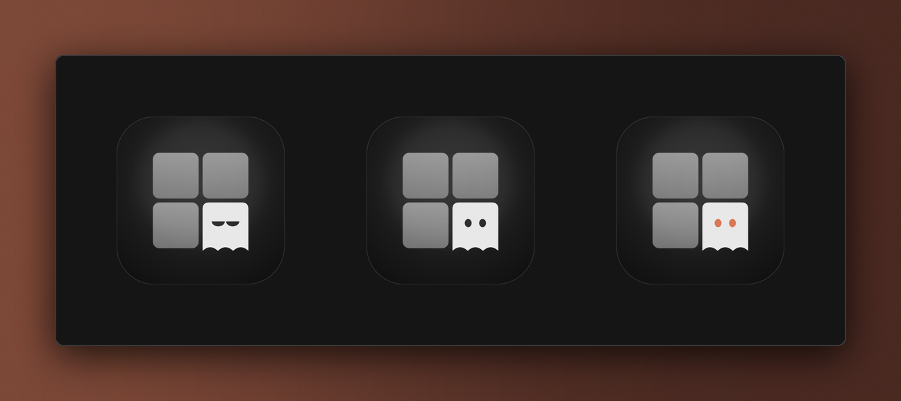

<div align="center">


# Dock ghost

**Haunt's Dock ghost sleeps, works and wakes with your agents.**

[](https://github.com/highskore/haunt-hackathon)


[](LICENSE)



</div>

The tile is Haunt's own icon, redrawn per state:

- **Asleep**: nothing running and nothing waiting. The Dock shows Haunt's plain icon with its sleepy eyes.
- **Working**: an agent is running. The ghost's eyes open and blink every few seconds.
- **Needs you**: an agent is waiting on you. Wide orange eyes, and the Dock's red badge counts the agents that need you.

Haunt does the blinking and skips it under Reduce Motion. The badge is the system's own Dock badge.

## Settings

```toml
[plugins."dev.haunt.dock-ghost"]
badge = true        # the red count of agents that need you
blink = true        # working eyes blink now and then
unverified = false  # also follow events without the tab's nonce
```

## Capabilities

| capability | why |
|---|---|
| `events` (session start, prompt, subagent, tool, permission request, question, notification, stop) | each agent's state; no event text is kept |
| `dock` | the Dock tile and its badge |
| `timer` | retries a refused show every 15 s |

Only one plugin owns the Dock tile at a time: if another has it, the ghost waits and tries again. `[plugin_fx] dock = false` in Haunt's config turns plugin Dock tiles off.

## Artwork

`src/tile.rs` draws the tiles from the geometry of Haunt's app icon (`design/icon/haunt.svg`); only the eyes change. `assets/*.svg` are its output and `assets/*.png` the 512 px tiles the plugin ships (Haunt takes at most 512 px). After changing the drawing, run `./assets.sh` (needs `rsvg-convert` from librsvg).

## Build and test

```sh
cargo build --release --target wasm32-wasip2   # or ./build.sh
cargo test                                     # unit tests
haunt plugin install .
```

`e2e/dock_ghost.rs` runs the built plugin against a real Haunt core: copy it into a Haunt checkout's `cli/tests/` and run `HAUNT_PLUGINS_DIR=<this repo's parent> cargo test -p haunt-cli --features plugins --test dock_ghost`.

Needs Haunt with plugin API 0.5 (`api = "0.5"`) and its `dock` import.

## Licence

MIT, see `LICENSE`.
